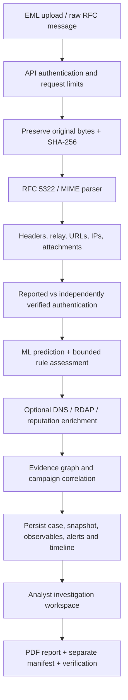
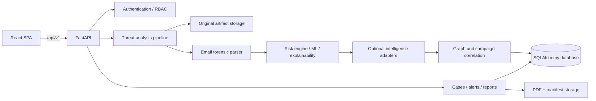

# MAILSPECTRA

**Email Forensics & Threat Intelligence Workspace**

MAILSPECTRA is an analyst-oriented application for examining suspicious email messages, extracting forensic observables, assessing potential threats, enriching indicators with bounded threat-intelligence lookups, correlating related investigations, and preserving evidence for review.

It combines a **FastAPI backend**, a **React investigation interface**, rule-based risk assessment, an inherited demonstration machine-learning model, optional infrastructure/reputation providers, evidence hashing, case management, and PDF reporting.

> **Project status:** MAILSPECTRA is an actively developed forensic investigation workbench. Its software tests and local deployment workflows have been exercised, but it is **not a production-validated email security product**. The bundled model is demonstration-only and uncalibrated; live provider accounts and external production hosting still require operator validation. Read [Limitations](#limitations-and-current-readiness) before relying on results.

<p align="left">
  
  
  
  
  
  
</p>

---

## Contents

- [1. What MAILSPECTRA does](#1-what-mailspectra-does)
- [2. Core capabilities](#2-core-capabilities)
- [3. Investigation workflow](#3-investigation-workflow)
- [4. Architecture](#4-architecture)
- [5. Application interface](#5-application-interface)
- [6. Risk assessment and machine learning](#6-risk-assessment-and-machine-learning)
- [7. Threat intelligence and enrichment](#7-threat-intelligence-and-enrichment)
- [8. Evidence preservation and reporting](#8-evidence-preservation-and-reporting)
- [9. Authentication, roles and security](#9-authentication-roles-and-security)
- [10. Technology stack](#10-technology-stack)
- [11. Repository structure](#11-repository-structure)
- [12. Local development setup](#12-local-development-setup)
- [13. Configuration reference](#13-configuration-reference)
- [14. API overview](#14-api-overview)
- [15. Database and storage](#15-database-and-storage)
- [16. Docker and deployment](#16-docker-and-deployment)
- [17. Running tests](#17-running-tests)
- [18. Limitations and current readiness](#18-limitations-and-current-readiness)
- [19. Troubleshooting](#19-troubleshooting)
- [20. Contributing](#20-contributing)
- [21. Attribution and licensing](#21-attribution-and-licensing)
- [Further documentation](#further-documentation)

---

## 1. What MAILSPECTRA does

Email remains a common delivery mechanism for phishing, credential theft, impersonation, payment fraud, malicious links, and other social-engineering attacks. Investigating a suspicious message requires more than checking its visible sender or subject: analysts may need to inspect raw headers, reconstruct relay paths, examine URLs and attachments, assess authentication evidence, review infrastructure, and preserve the original artifact.

MAILSPECTRA brings those activities into one investigation workflow.

### Design goals

1. **Preserve before interpreting.** Keep the uploaded message bytes and their SHA-256 digest separate from parsed and presentation data.
2. **Make evidence traceable.** Link extracted observations to the source artifact and a location in the parsed analysis snapshot.
3. **Separate claims from verification.** A result written inside an uploaded email header is not automatically trusted as an independently verified SPF, DKIM, or DMARC result.
4. **Explain risk.** Show the evidence categories and bounded contributions behind the canonical risk score.
5. **Enrich carefully.** Distinguish live provider results, offline fixtures, unavailable data, errors, and rate limits.
6. **Support investigations over time.** Persist cases, alerts, observables, timelines, and possible campaign relationships.
7. **Avoid unsafe handling.** Do not execute attachments or fetch URLs found in submitted email.
8. **State limitations honestly.** A heuristic score, a graph relationship, a hash match, or a small demonstration model is not proof of maliciousness, identity, or legal authenticity.

MAILSPECTRA is an investigation aid. It does not replace a secure email gateway, endpoint protection, malware sandbox, incident-response process, or a trained analyst.

## 2. Core capabilities

| Capability | What it does |
|---|---|
| Email ingestion | Accepts RFC 5322/MIME `.eml` files or pasted raw email text |
| Evidence preservation | Stores original bytes with a generated artifact identifier and SHA-256 digest |
| Header forensics | Parses sender, recipients, message identifiers, duplicate headers, authentication-related headers, and relay observations |
| MIME inspection | Describes MIME parts and extracts attachment metadata without executing files |
| Observable extraction | Extracts URLs, IP addresses, domains, mail-server information, and attachment hashes |
| Authentication analysis | Separates supplied header claims from independently established verification results |
| Threat assessment | Produces a bounded 0–100 risk score, classification, severity, and evidence breakdown |
| ML-assisted classification | Exposes the inherited Logistic Regression + TF-IDF demonstration model with explicit readiness warnings |
| Explainability | Presents model/rule indicators and feature contributions as decision-support evidence |
| Infrastructure intelligence | Provides bounded DNS, RDAP, IP information, and reputation enrichment |
| IOC workbench | Supports lookups through configured providers for supported indicator types |
| Threat graph | Visualizes entities and relationships with supporting evidence references |
| Campaign correlation | Finds cases with shared observables and temporal context; results are investigative leads, not actor attribution |
| Case management | Persists investigation snapshots, case status, priority, observables, and timeline events |
| Alert management | Persists qualifying alerts and supports acknowledgement and resolution |
| Privacy presentation | Offers best-effort masking in supported views and PDF report generation |
| Forensic reporting | Generates PDF reports and separate manifests, with distinct hashes for original and report files |
| Verification | Recalculates stored original/report digests and records relevant audit events |

### Input support

**Supported**
- RFC 5322/MIME `.eml` uploads.
- Raw email message text supplied to the analysis endpoint.

**Not supported**
- Outlook `.msg` parsing.
- Executing or detonating attachments.
- Fetching or opening URLs found in a message.
- Treating uploaded `Received` or `Authentication-Results` headers as trusted acquisition metadata.

The upload limit is configurable through `MAX_UPLOAD_SIZE_MB` (25 MB in the example configuration). The application validates content and enforces request-body limits, including streamed/chunked request bodies.

## 3. Investigation workflow

The typical analyst workflow is:

1. **Sign in.** An operator provisions an account; there is no public self-registration or shared demo account.
2. **Submit an email.** Upload an `.eml` message or paste raw message text.
3. **Preserve the artifact.** MAILSPECTRA stores the exact input bytes under a generated storage name and calculates SHA-256.
4. **Parse the message.** The parser extracts headers, duplicate header occurrences, MIME structure, relay observations, URLs, IPs, and attachment metadata.
5. **Assess authentication.** Submitted authentication claims remain labelled as unverified. Independent DKIM/ARC and applicable DNS-backed checks are represented separately; saved-message SPF remains unavailable when trusted SMTP peer/envelope data is absent.
6. **Calculate risk.** The canonical risk engine combines bounded model and rule evidence into a 0–100 score, with classification, severity, and an evidence breakdown.
7. **Enrich indicators.** Optional provider adapters retrieve bounded infrastructure and reputation information. Offline fixtures and unavailable results are labelled distinctly from live results.
8. **Correlate cases.** MAILSPECTRA builds an evidence graph and checks for shared observables and temporal proximity across stored cases.
9. **Investigate and manage.** Analysts review the result, save/reopen cases, update case status, and acknowledge or resolve alerts.
10. **Export evidence.** Generate a PDF report, inspect the separate manifest, and verify the original artifact or generated report digest.

The workflow is designed to preserve the distinction between the original message, extracted observations, external enrichment, the risk decision, and the analyst's later actions.

### Try the bundled synthetic demo

MAILSPECTRA includes three reproducible synthetic `.eml` scenarios: a benign newsletter, a credential-harvesting lure, and an executive payment-diversion message. The Investigate page's **Quick Demos** buttons load these same committed files from `frontend/public/demo-samples/`; the downloadable files and UI therefore share one source of truth.

Run locally with `INTELLIGENCE_MODE=offline`, sign in with a provisioned analyst account, and open **Investigate → Quick Demos**. Review the evidence, save a case, generate a PDF report, and verify both the original artifact and report digests. All sample domains use `.test`, and sample IP literals use RFC 5737 documentation ranges. Do not click message URLs. Embedded `Authentication-Results` fields remain untrusted message claims, not independent verification. The sample model output is illustrative and has no prescribed score or verdict.

See the complete [Demo walkthrough](docs/DEMO_WALKTHROUGH.md) and [synthetic sample manifest](data/demo/manifest.json).


## 4. Architecture

### High-level data flow



### Application architecture



### Backend responsibilities

- `backend/app/api/v1/endpoints/`: authentication, analysis, dashboard, alerts, cases, campaigns, intelligence, reports, health, and system routes.
- `backend/app/services/`: analysis orchestration, email parsing, evidence preservation, authentication verification, alerting, persistence/correlation, privacy, and PDF report generation.
- `backend/app/ml/`: feature extraction, prediction, training safeguards, risk scoring, schemas, and explanation.
- `backend/app/intelligence/`: provider adapters, DNS, RDAP, IP intelligence, reputation, caching, and bounded HTTP.
- `backend/app/graph/`: graph construction, campaign correlation, and graph schemas.
- `backend/app/models/`: SQLAlchemy persistence models.
- `backend/app/schemas/`: canonical Pydantic API contracts.
- `migrations/`: Alembic migration history.

### Frontend responsibilities

The React single-page application provides analyst views for the dashboard, investigation, cases, case details, campaigns, intelligence lookups, reports, and settings. API response types are generated from the backend schemas using `python -m scripts.generate_api_types`.

## 5. Application interface

| Page | Purpose |
|---|---|
| **Dashboard** | Displays investigation totals, recent activity, alert feed, and threat/risk distributions |
| **Investigate** | Accepts an email and displays its forensic analysis and decision-support findings |
| **Cases** | Lists persisted investigations and their status/priority |
| **Case detail** | Opens a stored case, its evidence, observables, timeline, and related analysis |
| **Campaigns** | Shows clusters and case relationships based on shared evidence |
| **Intelligence** | Provides the IOC lookup workbench and local entropy measurement |
| **Reports** | Lists generated forensic PDFs and supports report download/verification |
| **Settings** | Shows system configuration information available to the authenticated role |

### Investigation panels

The investigation workspace includes panels/components for:

- Verdict and risk summary.
- Header and authentication forensics.
- Relay-hop reconstruction.
- Extracted observables and attachment metadata.
- DNS/RDAP and geolocation/infrastructure information.
- Threat graph.
- Campaign attribution support.
- Content intelligence.
- SHAP/model explanation.
- Evidence and report actions.

A rendered relationship or correlation should always be interpreted with its source and confidence limitations. A map location is an infrastructure lookup result, not the physical location of a person.

## 6. Risk assessment and machine learning

### Canonical risk assessment

The authoritative new-analysis result is `risk_assessment`. It returns a risk score from 0 to 100, classification, severity, model confidence metadata, evidence breakdown, and security indicators.

The current bounded allocation is:

| Evidence category | Maximum contribution |
|---|---:|
| Model threat probability | 40 |
| Authentication evidence | 15 |
| Identity evidence | 15 |
| URL evidence | 15 |
| Attachment evidence | 10 |
| Content evidence | 5 |
| **Total** | **100** |

The risk score is the sum of bounded category contributions. Severity thresholds are centralized in `backend/app/core/assessment.py` and are shared by application consumers.

**Important interpretation notes**
- A score is a transparent engineering policy, not a calibrated probability of harm.
- Reported authentication headers are attacker-controlled claims; a reported pass does not lower the score as if it were independent verification.
- Reported failures may contribute a separately labelled investigative heuristic.
- Independently verified results retain their own method and limitations.
- Model and rule features can overlap; their contributions must not be assumed statistically independent.
- If the model is unavailable, the application does not convert the absence of a model result into proof that an email is safe.

See [Risk scoring](docs/RISK_SCORING.md) and [Security hardening](docs/SECURITY_HARDENING.md).

### Inherited demonstration model

The current bundled model is an inherited **Logistic Regression + TF-IDF / structured-feature baseline**. It exposes seven classes:

- `LEGITIMATE`
- `PHISHING`
- `BUSINESS_EMAIL_COMPROMISE`
- `IMPERSONATION`
- `FRAUD`
- `CREDENTIAL_HARVESTING`
- `SUSPICIOUS`

The demonstration corpus has only **21 messages (three per class)**. The evaluation workflow uses fold-local preprocessing, duplicate grouping, a frozen holdout, and a dataset checksum manifest. The small corpus and its unresolved data provenance do not support operational accuracy claims.

The model response deliberately advertises:

- `deployment_status = DEMONSTRATION_ONLY`
- `calibration_status = UNCALIBRATED`
- `production_ready = false`

Training creates candidate artifacts separately from the active model and includes safeguards against overwriting the deployed artifact. A candidate model is not automatically promoted.

**Before any operational ML use:** establish dataset authorship and redistribution rights, obtain representative labelled groups, define false-positive/false-negative costs, calibrate the model, and evaluate it on a sufficiently large independent holdout.

See [ML model card](docs/ML_MODEL_CARD.md).

## 7. Threat intelligence and enrichment

MAILSPECTRA distinguishes offline demonstration data from live observations.

### Modes

- `INTELLIGENCE_MODE=offline` is the safe default. Fixture data is labelled as a fixture; missing fixture data remains unavailable/unknown, not clean.
- `INTELLIGENCE_MODE=live` enables configured live-provider adapters. Provider failures are not replaced with offline fixture results.

### Implemented integrations and sources

| Source / provider | Use in MAILSPECTRA | Important limitation |
|---|---|---|
| DNS | Domain and mail infrastructure observations | DNS answers are time-dependent and do not prove historical delivery state |
| RDAP | Registration/registry information where supported | Only allowlisted RDAP hosts are queried |
| AbuseIPDB | IP reputation lookup | One provider score is not a consensus of independent engines |
| IPInfo | IP geolocation / network information | Requires an authorized token for live use |
| VirusTotal | Existing reports for supported IP/domain/URL/hash indicators | Lookup only; no file or URL submission is performed |
| Shodan | Existing IP host/infrastructure observations | Port/service observations are not a maliciousness verdict |
| Offline fixtures | Demonstration and test data | Never represent live provider observations |

Provider results distinguish states such as fixture, available, unavailable, error, and rate-limited. A missing credential, absent report, malformed response, or provider error must not become a clean verdict. Special-use IP ranges are excluded from live lookups.

External HTTP is bounded by allowlists, HTTPS, timeouts, redirect controls, and response-size limits. DNS and infrastructure enrichment also use bounded execution budgets. IOC lookups are cached with lookup timestamps and cache-hit metadata.

### Indicator privacy

A live lookup sends the selected indicator to the configured external provider. Do not enable live lookups for private or sensitive evidence unless the organization has authorized that disclosure. No extracted message URL is automatically visited, and no attachment is submitted or executed.

The Intelligence page's entropy measurement is a descriptive local character statistic. It is **not** a DGA classifier or proof that a domain is malicious.

See [Intelligence providers and disclosure](docs/INTELLIGENCE_PROVIDERS.md).

## 8. Evidence preservation and reporting

### Original artifacts

- Original message bytes are stored separately from derived analysis JSON.
- Storage filenames are generated by the application; the submitted filename is treated as metadata.
- Original artifacts are written with restricted filesystem permissions.
- SHA-256 is calculated from the exact input bytes.
- Extracted observations refer to the artifact and parsed snapshot location.
- Attachment metadata includes MIME-part context and hashes where available.

A digest match means the bytes currently checked match the recorded digest. A hash does **not** establish who sent the message, whether the supplied message was acquired from a trusted mail server, or whether the evidence is legally admissible.

### PDF reports and manifests

A generated report can include:

- Case and analysis summary.
- Original artifact digest.
- Risk assessment and explanation.
- Reported and independently verified authentication results.
- Relay-chain observations and limitations.
- URLs, IPs, attachments, and provider information.
- Graph/campaign context and timeline data.
- Model readiness caveats and known limitations.

Untrusted message-derived text is escaped before PDF markup rendering. Optional PII masking operates on a presentation copy and does not rewrite the preserved original.

The original artifact digest and generated PDF digest are separate. A report cannot contain its own final digest; the PDF digest is included in the accompanying manifest and persisted report metadata.

The manifest currently reports `PRESENT_UNVERIFIED` because there is no independently stored manifest digest. Evidence verification is not an external immutable ledger or a complete chain-of-custody guarantee.

### Privacy masking

Masking is best effort. It covers supported email/IP/known display-name patterns and presentation paths, but it is not guaranteed anonymization. Free-form text, unusual identifiers, embedded content, or context may still disclose personal information. Review every export before sharing it.

See [Evidence and chain of custody](docs/EVIDENCE_AND_CHAIN_OF_CUSTODY.md) and [Analyst workflow](docs/ANALYST_WORKFLOW.md).

## 9. Authentication, roles and security

### Account model

There is no public sign-up route, default admin, shared demo password, or anonymous private API access. An operator provisions accounts through the command-line account utility.

| Role | Intended access |
|---|---|
| `viewer` | Read-only investigation access |
| `analyst` | Analyze email, update cases, manage alerts, and generate reports |
| `admin` | Analyst capabilities plus access to protected system settings |

The application is currently a **single-organization** system. It does not provide tenant isolation, SSO, or MFA.

### Session security

- Passwords use salted scrypt hashes.
- Access JWTs are signed and short-lived (15 minutes by default).
- Each access token references a database-backed session checked during protected requests.
- Refresh tokens are opaque random values delivered in an HttpOnly cookie; only token digests are stored in the database.
- Refresh rotates tokens. Reuse of a consumed refresh token revokes the associated session family.
- Production refresh cookies use Secure, HttpOnly, and SameSite=Strict settings.
- Logout revokes the session family and clears the refresh cookie.
- Role checks are enforced by the API, not by client-side claims alone.

Keep the frontend and API on the same site for the current SameSite=Strict refresh-cookie policy. Browser access tokens are held in session-scoped storage, so XSS protection remains important.

### Email and network safety

- Submitted headers and bodies are untrusted.
- Raw email HTML is not rendered as active content.
- Attachments are not executed.
- URLs in messages are not automatically fetched.
- Provider requests are restricted to supported hosts and bounded responses.
- API request bodies are size-limited.
- Production configuration requires a strong signing key, explicit CORS origins, debug disabled, and an explicit database URL.

For operational threat assumptions and residual risks, read [Threat model](docs/THREAT_MODEL.md) and [Security hardening](docs/SECURITY_HARDENING.md).

## 10. Technology stack

| Layer | Technologies |
|---|---|
| Backend API | Python 3.11, FastAPI, Uvicorn, Pydantic v2 |
| Database access | SQLAlchemy 2.x async ORM, Alembic migrations |
| Local database | SQLite with aiosqlite |
| Production database option | PostgreSQL with asyncpg |
| Machine learning | scikit-learn 1.7.2, TF-IDF, Logistic Regression, NumPy, SciPy, joblib |
| Explainability | SHAP |
| Graph and correlation | NetworkX |
| Email parsing | Python email/MIME tooling, BeautifulSoup, tldextract |
| Authentication verification | PyJWT, dkimpy, pyspf, dnspython, authres |
| Intelligence | DNS, RDAP and provider-specific HTTPS adapters |
| PDF reporting | ReportLab |
| Frontend | React 18, React Router, Vite 7 |
| UI and visualization | Tailwind CSS, Recharts, React Flow, Leaflet, Lucide React |
| Frontend runtime/tooling | Node.js 24, npm |

## 11. Repository structure

```text
MAILSPECTRA/
├── backend/
│   ├── app/
│   │   ├── api/v1/
│   │   │   └── endpoints/       # Auth, analysis, cases, alerts, reports, etc.
│   │   ├── analyzers/           # Content analysis
│   │   ├── core/                # Settings, security, scoring policy, logging
│   │   ├── database/            # SQLAlchemy engine and sessions
│   │   ├── graph/               # Threat graph and campaign correlation
│   │   ├── intelligence/        # DNS, RDAP, reputation and provider clients
│   │   ├── ml/                  # Features, model, scoring and explanations
│   │   ├── models/              # SQLAlchemy entities
│   │   ├── schemas/             # Canonical API schemas
│   │   ├── services/            # Parsing, pipeline, evidence, reports, etc.
│   │   └── utils/               # Shared parsing/network/crypto utilities
│   └── run.py                   # Backend entry point
├── data/
│   └── training/                # Demonstration training data and manifest
├── docs/                        # Architecture, security, API and operations docs
├── frontend/
│   ├── src/
│   │   ├── api/                 # API client
│   │   ├── components/          # Layout and investigation panels
│   │   ├── context/             # Authentication and privacy state
│   │   ├── pages/               # Dashboard and analyst pages
│   │   └── types/               # Generated API TypeScript declarations
│   └── tests/                   # Privacy and frontend contract checks
├── migrations/
│   └── versions/                # Alembic schema migrations
├── reports/                     # Local report output directory
├── scripts/                     # API type generation and tooling
├── tests/                       # Backend, API, security and integration tests
├── .env.example                 # Example local configuration
├── Dockerfile
├── docker-compose.yml
├── render.yaml
├── requirements.txt
└── README.md
```

## 12. Local development setup

### Prerequisites

- Python **3.11**.
- Node.js **24** and npm.
- Git.
- SQLite for the default local setup. PostgreSQL is optional for local integration testing and recommended for production.
- A terminal with permission to create a virtual environment and write to the configured storage directories.

### 12.1 Clone the repository

```bash
git clone https://github.com/SwapnanilTripathy/MAILSPECTRA.git
cd MAILSPECTRA
```

### 12.2 Create and activate the Python environment

**Linux / macOS / Codespaces**

```bash
python3.11 -m venv .venv
source .venv/bin/activate
```

**Windows PowerShell**

```powershell
py -3.11 -m venv .venv
.\.venv\Scripts\Activate.ps1
```

### 12.3 Install backend dependencies

```bash
python -m pip install --upgrade pip
python -m pip install -r requirements.txt
```

### 12.4 Configure the environment

```bash
cp .env.example .env
```

On Windows PowerShell:

```powershell
Copy-Item .env.example .env
```

The example configuration uses a local SQLite database, offline intelligence mode, and DNS authentication verification disabled. Review `.env` before starting the application. Never commit secrets or real provider credentials.

### 12.5 Apply database migrations

```bash
python -m alembic upgrade head
```

Migrations create and evolve the application schema. Do not point development tests at a production database or evidence directory.

### 12.6 Create the first administrator

```bash
python -m backend.app.manage_users admin --role admin
```

The command prompts privately for a password and confirmation. Passwords must be 12–256 characters. There are no seeded default credentials.

Create additional accounts as needed:

```bash
python -m backend.app.manage_users analyst01 --role analyst
python -m backend.app.manage_users viewer01 --role viewer
```

### 12.7 Install frontend dependencies

```bash
npm --prefix frontend ci
```

### 12.8 Start the backend

In the first terminal, from the repository root with the virtual environment active:

```bash
python backend/run.py
```

The development API listens on port **8000**.

### 12.9 Start the frontend

In a second terminal, from the repository root:

```bash
npm --prefix frontend run dev -- --host 0.0.0.0
```

Vite listens on port **3000** and proxies `/api` requests to the backend at `http://127.0.0.1:8000`.

### 12.10 Open MAILSPECTRA

- Frontend: [http://localhost:3000](http://localhost:3000)
- Backend health: [http://localhost:8000/api/v1/health](http://localhost:8000/api/v1/health)
- Backend readiness: [http://localhost:8000/api/v1/ready](http://localhost:8000/api/v1/ready)
- API documentation: [http://localhost:8000/docs](http://localhost:8000/docs)
- OpenAPI schema: [http://localhost:8000/api/v1/openapi.json](http://localhost:8000/api/v1/openapi.json)

Sign in using the account created in step 12.6.

## 13. Configuration reference

The application reads environment variables and, in local development, values from `.env`.

| Variable | Purpose | Example / default |
|---|---|---|
| `APP_ENV` | Runtime environment | `development` |
| `DEBUG` | Enables development debugging | `false` |
| `SECRET_KEY` | Signs access tokens | Empty in example; development generates a temporary key |
| `CORS_ORIGINS` | Explicit allowed browser origins | Localhost origins in `.env.example` |
| `DATABASE_URL` | Async database connection | `sqlite+aiosqlite:///./deeptrace.db` locally |
| `ALLOW_SQLITE_PRODUCTION` | Explicitly permits single-instance SQLite production | `false` |
| `ACCESS_TOKEN_MINUTES` | Access-token lifetime | `15` |
| `REFRESH_TOKEN_DAYS` | Session-family lifetime | `7` |
| `UPLOAD_DIR` | Original evidence storage directory | `./uploads` |
| `REPORTS_DIR` | Generated report storage directory | `./reports` |
| `MAX_UPLOAD_SIZE_MB` | Maximum request/upload size policy | `25` |
| `INTELLIGENCE_MODE` | Offline fixture or live provider mode | `offline` |
| `VERIFY_AUTHENTICATION_DNS` | Enables bounded DNS-backed DKIM/ARC/DMARC verification where possible | `false` |
| `TRUSTED_RECEIVERS` | Configured receiver trust hints | Empty by default |
| `DNS_TIMEOUT_SECONDS` | DNS query budget | `3` |
| `HTTP_INTEL_TIMEOUT_SECONDS` | Provider HTTP timeout | `5` |
| `CACHE_TTL_HOURS` | Intelligence cache lifetime | `24` |
| `VIRUSTOTAL_API_KEY` | Optional VirusTotal access | Empty |
| `ABUSEIPDB_API_KEY` | Optional AbuseIPDB access | Empty |
| `IPINFO_TOKEN` | Optional IPInfo access | Empty |
| `SHODAN_API_KEY` | Optional Shodan access | Empty |

### Database configuration

**Local development:** SQLite is the default. The example path is named `deeptrace.db` for compatibility with the inherited project configuration.

**Production:** Supply an explicit `DATABASE_URL`. PostgreSQL is recommended. PostgreSQL URLs using `postgres://` or `postgresql://` are normalized for the async SQLAlchemy driver.

SQLite production is permitted only when the operator deliberately sets an explicit SQLite URL and `ALLOW_SQLITE_PRODUCTION=true`. It is a single-instance/single-writer deployment option, not a horizontal scaling strategy.

### Production configuration requirements

At minimum:

- `APP_ENV=production`.
- `DEBUG=false`.
- A random `SECRET_KEY` of at least 32 characters.
- An explicit `DATABASE_URL`.
- Exact production `CORS_ORIGINS`; no wildcard origin with credentials.
- Durable and correctly permissioned upload/report storage.
- HTTPS at a trusted hosting proxy.
- Migrations applied before the application starts.
- Backups that include both the database and matching evidence/report files.

Do not place secrets in Git, screenshots, issue comments, example files, or exported reports.

## 14. API overview

The API is versioned under `/api/v1`. The interactive OpenAPI documentation is available at `/docs` when the backend is running.

| Area | Method and path | Purpose |
|---|---|---|
| Health | `GET /api/v1/health` | Process health |
| Readiness | `GET /api/v1/ready` | Database, schema, and storage readiness |
| Authentication | `POST /api/v1/auth/login` | Start an authenticated session |
| Authentication | `POST /api/v1/auth/refresh` | Rotate refresh token and issue access token |
| Authentication | `GET /api/v1/auth/me` | Retrieve current user profile |
| Authentication | `POST /api/v1/auth/logout` | Revoke the current session family |
| Analysis | `POST /api/v1/analyze/email` | Analyze an uploaded `.eml` file |
| Analysis | `POST /api/v1/analyze/raw` | Analyze raw message text |
| Dashboard | `GET /api/v1/dashboard/stats` | Aggregated metrics |
| Dashboard | `GET /api/v1/dashboard/recent` | Recent investigations |
| Dashboard | `GET /api/v1/dashboard/distribution` | Threat and risk distributions |
| Alerts | `GET /api/v1/alerts` | List persisted alerts |
| Alerts | `PATCH /api/v1/alerts/{alert_id}` | Update alert state |
| Cases | `GET /api/v1/cases` | List cases |
| Cases | `GET /api/v1/cases/{case_id}` | Retrieve case detail |
| Cases | `POST /api/v1/cases` | Create a case |
| Cases | `PATCH /api/v1/cases/{case_id}/status` | Update case status |
| Evidence | `GET /api/v1/cases/{case_id}/evidence/verify` | Verify original evidence digest |
| Campaigns | `GET /api/v1/campaigns` | List campaign clusters |
| Campaigns | `GET /api/v1/campaigns/{campaign_id}` | Retrieve campaign detail |
| Intelligence | `POST /api/v1/intelligence/lookup` | Lookup a supported indicator |
| Reports | `GET /api/v1/reports` | List generated reports |
| Reports | `POST /api/v1/reports/generate/{case_id}` | Generate a PDF report |
| Reports | `GET /api/v1/reports/{case_id}/download` | Download a PDF report |
| Reports | `GET /api/v1/reports/{case_id}/verify` | Verify current PDF digest |
| Reports | `GET /api/v1/reports/{case_id}/manifest` | Retrieve report manifest |
| System | `GET /api/v1/system/status` | Operational status |
| System | `GET /api/v1/system/settings` | Non-sensitive system settings (admin access) |

Private API routes require authentication. Role authorization is applied at protected route boundaries. Consult the generated OpenAPI schema for request bodies, response models, query parameters, and error responses.

## 15. Database and storage

### Persistent records

The database stores user and session data, login attempts, cases, analysis snapshots, observables, timeline events, audit records, alerts, campaign information, and intelligence-cache data.

The full derived analysis snapshot is separate from the original message bytes. Re-uploading identical original bytes can reopen the corresponding existing analysis rather than create an unrelated duplicate.

### Storage locations

- `UPLOAD_DIR`: preserved original email artifacts.
- `REPORTS_DIR`: generated PDF reports and accompanying manifest files.
- Database: SQLite locally by default, or an explicitly configured PostgreSQL service.

Original files and reports are not served as public static content. Authorized endpoints control downloads.

### Migrations

Alembic migrations are required. Production startup/readiness checks the expected schema revision and does not silently create an uninitialized production database. Apply `python -m alembic upgrade head` as part of deployment operations.

### Backups

The database and evidence/report directories must be backed up as a coordinated set. With SQLite, the database may live in the persistent evidence volume. With PostgreSQL, take a consistent provider-managed database backup in addition to the evidence-volume backup. Restoring only one side can leave case records pointing to missing files or evidence files without their database references.

See [Deployment and operations](docs/DEPLOYMENT.md) for backup, restore, migration, and retention procedures.

## 16. Docker and deployment

### Docker Compose

Configure private environment values in `.env`, including `SECRET_KEY`, `CORS_ORIGINS`, and `DATABASE_URL`. PostgreSQL is recommended; Compose does not provision an external PostgreSQL service. For a deliberately approved, single-instance SQLite production setup, use an explicit SQLite URL and set `ALLOW_SQLITE_PRODUCTION=true`.

From the repository root:

```bash
docker compose build
docker compose run --rm mailspectra python -m alembic upgrade head
docker compose run --rm mailspectra python -m backend.app.manage_users admin --role admin
docker compose up -d
```

Check readiness:

```bash
curl --fail http://localhost:8000/api/v1/ready
```

The container runs the application as a non-root user. The persistent storage volume contains uploaded original email artifacts and generated reports/manifests. When SQLite is selected explicitly, it also contains the SQLite database. When PostgreSQL is used, the database is external and must be backed up separately.

Do not remove persistent volumes when preserving evidence. Never run destructive volume-cleanup commands against a volume containing evidence you need.

### Render blueprint

The repository includes `render.yaml` as a deployment blueprint. It declares a Docker web service and persistent evidence disk, but it **does not provision a PostgreSQL database**. An authorized operator must configure the intended private `DATABASE_URL`, CORS origin, generated signing secret, storage ownership, HTTPS, and backups before deployment.

The repository has not been validated on an external production hosting environment. A local container build or isolated PostgreSQL test is not proof of external TLS, availability, backup recovery, or live-provider readiness.

See [Deployment and operations](docs/DEPLOYMENT.md) and [Security hardening](docs/SECURITY_HARDENING.md) before deploying.

## 17. Running tests

Run tests against a disposable local test database and temporary storage paths. **Never point test commands at production data or evidence directories.**

### Backend suite

Linux/macOS:

```bash
DATABASE_URL=sqlite+aiosqlite:////tmp/mailspectra-tests.db \
INTELLIGENCE_MODE=offline \
DEBUG=false \
REPORTS_DIR=/tmp/mailspectra-test-reports \
UPLOAD_DIR=/tmp/mailspectra-test-uploads \
python -m pytest -q --tb=short
```

### Frontend tests

```bash
npm --prefix frontend test
npm --prefix frontend run build
```

### API type generation / drift check

```bash
python -m scripts.generate_api_types
git diff --exit-code -- frontend/src/types/analysis.d.ts
```

### Formatting / whitespace check

```bash
git diff --check
```

### Coverage areas

The repository's tests cover:

- Authentication, token lifecycle, role authorization, and login throttling.
- Request size enforcement and input validation.
- Email parsing, duplicate headers, MIME structure, and observable extraction.
- Reported-authentication forgery and independent DKIM/ARC verification fixtures.
- Risk-policy boundaries and score normalization.
- Evidence storage, original/report hash verification, and manifest behavior.
- Alert persistence and state updates.
- Case persistence and correlation evidence.
- Provider adapters, invalid indicators, offline fixtures, unavailable states, and cache behavior.
- Frontend privacy masking and API-contract render checks.
- End-to-end synthetic investigation workflows.

External-provider mocks do not validate real provider credentials, quotas, terms, or historical DNS behavior. See [Testing and verification](docs/TESTING.md) for more detail.

## 18. Limitations and current readiness

MAILSPECTRA includes useful forensic and analyst workflows, but the following limits are material.

| Area | Current limitation |
|---|---|
| ML dataset | Only 21 inherited messages; three per class |
| ML evaluation | Holdout and cross-validation samples are too small to establish operational accuracy |
| ML calibration | Probabilities remain uncalibrated; model is marked demonstration-only |
| Dataset rights | Authorship and redistribution rights for inherited sample messages are not independently established |
| SPF | A saved `.eml` does not provide trusted SMTP peer IP, envelope sender, and HELO acquisition context; SPF is unavailable without it |
| DKIM / DMARC / ARC | Verification may depend on current DNS keys/policies, which can differ from delivery-time records |
| Relay chain | `Received` headers in a submitted message can be forged unless the acquisition/trust boundary is established |
| Threat intelligence | Live accounts, credentials, quotas, terms, and provider results require validation in the intended environment |
| Geolocation | Describes IP/network infrastructure, not the physical location or identity of a person |
| Correlation | Shared indicators and time proximity are investigative support, not proof of a common actor or campaign |
| Privacy | PII masking is best effort, not guaranteed anonymization |
| Evidence manifest | Manifest is labelled `PRESENT_UNVERIFIED`; no independently stored manifest digest exists |
| Audit | Application audit records are not an external immutable audit ledger |
| Retention | No automatic deletion/legal-hold engine is provided; policy and coordinated cleanup remain operator responsibilities |
| Deployment | External production hosting, TLS, provider configuration, and disaster-recovery restore remain unverified |
| Identity platform | Single-organization roles only; no SSO, MFA, or tenant isolation |
| File formats | Outlook `.msg` is unsupported |

### Safe interpretation

- Treat the model and risk score as **decision support**, not a verdict guaranteed to be correct.
- Review the raw source and extraction provenance for important findings.
- Distinguish provider observations from offline fixtures and unavailable results.
- Do not describe a hash match as proof of sender identity or evidence acquisition authenticity.
- Review redacted PDFs before distributing them.
- Do not deploy with real organizational mail until data handling, provider disclosure, access controls, retention, and hosting have been approved.

## 19. Troubleshooting

### Frontend cannot reach the API

- Confirm the backend is running on port 8000.
- Confirm Vite is running on port 3000.
- Check that the Vite `/api` proxy points to `http://127.0.0.1:8000`.
- Open `http://localhost:8000/api/v1/health` and `/api/v1/ready` to separate process health from database/storage readiness.

### Login fails

- Confirm an account was created with `python -m backend.app.manage_users USERNAME --role admin` (or another supported role).
- Confirm the username and password are correct; there is no default/demo account.
- Verify migrations were applied and the application is using the intended database URL.
- Check whether persistent login throttling has temporarily blocked repeated attempts.

### Database migration/readiness fails

- Confirm `DATABASE_URL` is valid for the selected async driver.
- Run `python -m alembic upgrade head` before starting the service.
- Confirm the configured database is reachable and the application user has the required permissions.
- In production, do not bypass the migration gate or fall back silently to SQLite.

### Live intelligence is unavailable

- Offline mode is the default.
- Check that live mode and the necessary provider credentials have been explicitly configured.
- Review the returned state (unavailable, error, rate-limited, no known match) rather than interpreting every missing result as a clean indicator.
- Remember that provider lookup discloses the submitted indicator to that provider.

### Upload is rejected

- Use an RFC 5322/MIME `.eml` file or raw RFC message text.
- Outlook `.msg` is not supported.
- Check the `MAX_UPLOAD_SIZE_MB` setting and ensure the message has valid headers.

## 20. Contributing

Contributions should preserve MAILSPECTRA's evidence-first and trust-aware design.

1. Open an issue describing the bug, security concern, or proposed improvement.
2. Keep changes scoped and add regression tests for behavior changes.
3. Update backend Pydantic schemas before changing generated frontend contracts.
4. Regenerate TypeScript declarations with `python -m scripts.generate_api_types`.
5. Run backend tests, frontend tests, the production frontend build, and the API type drift check.
6. Update the relevant documentation when an API, provider, scoring, security, or deployment behavior changes.
7. Never commit private emails, credentials, signing keys, provider tokens, real customer data, or generated evidence/report artifacts.
8. For security-sensitive findings, avoid publishing exploit details in a public issue before maintainers have assessed the report.

## 21. Attribution and licensing

MAILSPECTRA is derived from the inherited **DEEPTRACE / SIH26106** project, originally developed by **sidharth63 / Team DEEP thinkers**. The repository retains the upstream MIT license and its original copyright notice in [LICENSE](LICENSE). This history is preserved intentionally; MAILSPECTRA's current branding does not remove upstream attribution.

The repository also contains a dependency-license inventory in [docs/dependency-licenses.json](docs/dependency-licenses.json). That inventory is informational and does not replace the license texts or notice obligations of individual dependencies.

The inherited training samples have separately unresolved authorship and redistribution provenance. The repository's MIT license should not be interpreted as proof that every inherited sample message is cleared for redistribution or operational training.

---

## Further documentation

| Document | Description |
|---|---|
| [Architecture](docs/ARCHITECTURE.md) | Backend/frontend architecture and data flow |
| [Analyst workflow](docs/ANALYST_WORKFLOW.md) | Investigation, case, alert, privacy, and reporting workflow |
| [API contracts](docs/API.md) | Canonical response contracts and frontend bindings |
| [Data dictionary](docs/DATA_DICTIONARY.md) | Meaning of analysis fields and persistence records |
| [Email forensics](docs/EMAIL_FORENSICS.md) | Parsing and authentication-verification methodology |
| [Evidence and chain of custody](docs/EVIDENCE_AND_CHAIN_OF_CUSTODY.md) | Artifact preservation, observations, manifests, and hashes |
| [Risk scoring](docs/RISK_SCORING.md) | Risk policy and score interpretation |
| [ML model card](docs/ML_MODEL_CARD.md) | Dataset, evaluation, calibration, and deployment status |
| [Intelligence providers](docs/INTELLIGENCE_PROVIDERS.md) | Provider integrations, disclosure, and limitations |
| [Threat model](docs/THREAT_MODEL.md) | Assets, trust boundaries, threats, and residual risks |
| [Security hardening](docs/SECURITY_HARDENING.md) | Authentication trust, refresh-token lifecycle, and deployment requirements |
| [Deployment](docs/DEPLOYMENT.md) | Docker, Render, migrations, backup, restore, and retention |
| [Testing](docs/TESTING.md) | Test commands and validation coverage |
| [Dependency licenses](docs/DEPENDENCY_LICENSES.md) | Dependency inventory and licensing notes |
| [Demo walkthrough](docs/DEMO_WALKTHROUGH.md) | Reproducible synthetic email scenarios and end-to-end analyst workflow |
| [Changelog](docs/CHANGELOG.md) | Summary of specification implementation changes |

---

<p align="center">
  <strong>MAILSPECTRA</strong><br />
  <sub>Preserve the evidence. Understand the signals. Support the investigation.</sub>
</p>
