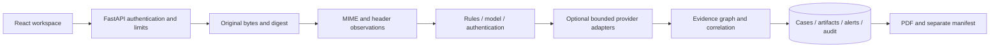

<!-- coderabbit-ai-generated:v1 -->

<!-- coderabbit-ai-generated-section:v1:f1ccfd5a29ac249c161620e4984202c1bbae7c539bf9f364978e7165ac21cd90 -->

# Architecture

The React SPA calls `/api/v1` using short-lived bearer sessions. Vite proxies local development calls to port 8000; the production FastAPI process serves the compiled SPA and API from one origin. Authentication is enforced at protected router boundaries; authorization uses persisted user roles, not client claims.

`services/threat_pipeline.py` orchestrates ingestion and persistence. Original files are stored with generated names outside the web root; derived JSON snapshots are separate. SQL transaction boundaries cover records, observations, alerts and audit. Filesystem and SQL cannot form a single atomic transaction; normal failures clean up new files, while crash recovery requires storage reconciliation.

`schemas/` contains canonical Pydantic response types; `scripts/generate_api_types.py` emits frontend declarations. `models/entities.py` maps database tables. Alembic adopts the legacy schema at 0001 and adds security/evidence/alert records at 0002. Production verifies the revision and refuses implicit initialization.

Provider adapters distinguish unavailable, errors, fixtures and available results. Outbound HTTP is HTTPS/host allowlisted, bounded and time-limited. Saved-message authentication separates supplied claims from DNS-backed verification. No trusted SMTP acquisition context is invented.

SQLite with one service instance and a persistent volume is the tested deployment. Analysis runs in the API process; bounded uploads and provider budgets do not provide queue isolation or CPU admission control. Scale-out jobs, distributed rate limiting and multi-tenant ownership need additional architecture.

<!-- /coderabbit-ai-generated:v1 -->